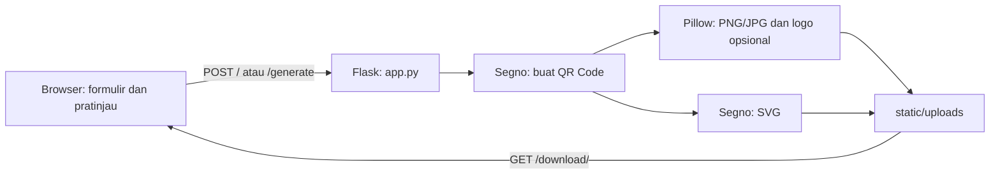

# Cellion Studio QR Generator

Aplikasi web berbasis Flask untuk membuat QR Code dari URL atau teks. Pengguna dapat melihat pratinjau langsung, memilih warna kode dan latar, menambahkan logo di tengah QR Code untuk hasil PNG/JPG, lalu mengunduhnya sebagai PNG, JPG, atau SVG. Aplikasi ditujukan bagi pengguna yang membutuhkan cara sederhana untuk membuat QR Code yang dapat disesuaikan.

## Fitur Utama

- Membuat QR Code dari teks atau URL dengan tingkat koreksi kesalahan `H`.
- Menampilkan pratinjau QR Code secara langsung di browser.
- Mengatur warna QR Code dan warna latar.
- Menambahkan logo di tengah QR Code pada keluaran PNG dan JPG.
- Mengunduh hasil dalam format PNG, JPG, atau SVG.
- Mengganti tampilan antarmuka antara tema terang dan gelap.

## Teknologi yang Digunakan

| Teknologi | Kegunaan | Versi yang diketahui |
|---|---|---|
| Python | Bahasa dan runtime aplikasi | Versi minimum belum ditentukan |
| Flask | Aplikasi web dan perutean | Tidak dipatok di repositori |
| Segno | Pembuatan QR Code di server | Tidak dipatok di repositori |
| Pillow | Pemrosesan gambar dan logo | Tidak dipatok di repositori |
| python-dotenv | Memuat konfigurasi dari `.env` | Tidak dipatok di repositori |
| EasyQRCodeJS | Pratinjau QR Code di browser | 4.5.0 (CDN) |
| Bootstrap | Komponen dan tata letak antarmuka | 5.3.0 (CDN) |
| Bootstrap Icons | Ikon antarmuka | 1.11.1 (CDN) |
| Plus Jakarta Sans | Font antarmuka | Dimuat dari Google Fonts |

Repositori belum menyediakan berkas dependensi seperti `requirements.txt` atau `pyproject.toml`. Versi Python dan versi pustaka server tidak dipatok.

## Struktur Proyek

```text
.
├── app.py                     # Aplikasi Flask, pembuatan QR Code, dan rute unduhan
├── templates/
│   └── index.html             # Formulir, pratinjau, dan halaman utama
└── static/
    ├── css/
    │   └── style.css          # Gaya dan tema antarmuka
    ├── js/
    │   └── script.js          # Pratinjau QR Code dan pergantian tema
    └── uploads/               # Lokasi keluaran QR Code; dibuat otomatis oleh aplikasi
```

## Prasyarat

- Python 3 dan `pip`.
- Koneksi internet saat membuka antarmuka agar pustaka CSS/JavaScript dan font yang dimuat dari CDN tersedia.

Versi minimum Python belum dinyatakan dalam konfigurasi proyek.

## Instalasi

Contoh berikut menggunakan PowerShell di Windows dari direktori proyek:

```powershell
py -m venv .venv
.\.venv\Scripts\Activate.ps1
python -m pip install --upgrade pip
python -m pip install Flask segno Pillow python-dotenv
```

Jika PowerShell menolak aktivasi skrip, Anda dapat menjalankan interpreter virtual environment secara langsung dengan `\.venv\Scripts\python.exe` sebagai pengganti `python`.

## Konfigurasi

Aplikasi memanggil `load_dotenv()`, sehingga nilai dalam `.env` akan dimuat bila berkas tersebut tersedia. Variabel yang tercatat di `.env` lokal proyek adalah sebagai berikut. Nilai aktual tidak ditampilkan di dokumentasi ini.

| Nama | Deskripsi | Contoh nilai | Wajib/opsional |
|---|---|---|---|
| `SECRET_KEY` | Kunci Flask; jika tidak diatur, aplikasi memakai nilai fallback yang tertulis di `app.py`. | `ganti-dengan-kunci-acak` | Opsional menurut kode; disarankan diatur sendiri |
| `PORT` | Port server pengembangan; nilai bawaan `5000`. | `5000` | Opsional |
| `FLASK_ENV` | Ada pada `.env` lokal, tetapi tidak dibaca langsung oleh kode aplikasi. | — | Opsional/tidak digunakan langsung |
| `MAX_CONTENT_LENGTH` | Ada pada `.env` lokal, tetapi aplikasi tidak menerapkannya sebagai batas unggahan. | — | Opsional/tidak digunakan langsung |

Tidak ada berkas `.env.example`. Buat `.env` sendiri bila perlu mengatur `SECRET_KEY` atau `PORT`. Jangan memasukkan rahasia ke repositori.

## Cara Menjalankan

Jalankan server pengembangan:

```powershell
python app.py
```

Buka `http://127.0.0.1:5000/` di browser. Jika `PORT` diatur, gunakan port tersebut. Aplikasi juga menerima `POST /generate` untuk pemrosesan formulir.

`app.py` menjalankan Flask dengan `debug=True`. Karena itu, perintah tersebut hanya sesuai untuk pengembangan. Repositori tidak menyediakan konfigurasi server produksi atau Docker; cara menjalankan produksi perlu ditentukan sebelum aplikasi dipublikasikan.

## Rute Aplikasi

Aplikasi ini menyediakan antarmuka web dan unduhan berkas, bukan API JSON.

| Metode | Path | Deskripsi |
|---|---|---|
| `GET` | `/` | Menampilkan halaman pembuat QR Code. |
| `POST` | `/` | Membuat QR Code dari formulir dan menampilkan tautan unduhan. Kolom formulir: `text_data`, `file_format`, `dark_color`, `light_color`, dan berkas opsional `logo`. |
| `POST` | `/generate` | Alias pemrosesan formulir yang sama dengan `POST /`. |
| `GET` | `/download/<fmt>` | Mengunduh QR Code dengan `fmt` berupa `png`, `jpg`, atau `svg`. |

Hasil pembuatan disimpan pada `static/uploads/generated_qr.<fmt>` dan diunduh dengan nama `custom_qr_studio.<fmt>`. Nama berkas keluaran tetap, sehingga pembuatan QR Code berikutnya dengan format sama akan menggantikan berkas sebelumnya. Permintaan yang berhasil merender halaman HTML dengan tautan unduhan; rute unduhan mengirim berkas, bukan respons JSON.

## Alur Kerja



Pratinjau dibuat di sisi browser oleh EasyQRCodeJS. Saat formulir dikirim, Flask membuat berkas QR Code di server dan halaman menampilkan tautan unduh.

## Pengujian dan Kualitas Kode

Repositori tidak menyertakan tes, konfigurasi lint/format, atau skrip untuk menjalankannya. Tidak ada perintah pengujian atau linting proyek yang dapat didokumentasikan.

## Deployment

Belum ada konfigurasi deployment, Docker, atau server WSGI produksi di repositori. Perintah `python app.py` mengaktifkan mode debug dan hanya ditujukan untuk pengembangan. Sebelum deployment, konfigurasi server produksi dan penonaktifan debug perlu ditambahkan.

## Lisensi

Tidak ditemukan berkas `LICENSE`, sehingga lisensi proyek belum dinyatakan.
